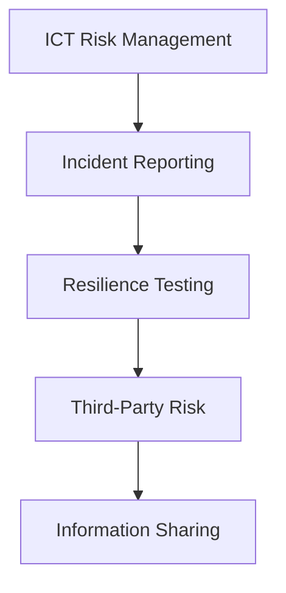

# DORA Compliance

The **Digital Operational Resilience Act (DORA)** is a binding European Union regulation that became fully applicable on **January 17, 2025**. It establishes a unified regulatory framework for information and communication technology (ICT) security and resilience across the EU financial services sector, replacing previous fragmented national rules.

DORA applies to a broad range of entities, including banks, insurance firms, investment managers, and crypto-asset providers, as well as their critical third-party ICT service providers (e.g., cloud platforms).

---

## The 5 Pillars of DORA

DORA is structured around five core operational pillars:

### 1. ICT Risk Management
* Financial entities must establish and maintain a comprehensive, well-documented ICT risk management framework.
* Management bodies (e.g., Board of Directors) bear ultimate accountability for defining risk tolerance and approving ICT security policies.
* Firms must identify critical business functions and protect them using robust security tools, encryption, and regular monitoring.

### 2. ICT-Related Incident Reporting
* Establish procedures to identify, log, and classify ICT incidents.
* **Mandatory Reporting**: Major ICT incidents must be reported to the supervisory competent authorities within strict timelines (initial notification, intermediate update, and final report with root-cause analysis).

### 3. Digital Operational Resilience Testing
* Entities must perform regular testing of all critical ICT systems (at least annually) to identify vulnerabilities.
* **Advanced Testing**: Large, systemically important institutions must conduct Threat-Led Penetration Testing (TLPT) (also known as "red teaming") every three years, using certified external testers.

### 4. ICT Third-Party Risk Management
* Banks must actively manage risks associated with critical technology vendors.
* Establish a standardized **Register of Information** detailing all outsourcing contracts.
* Critical third-party ICT providers (e.g., AWS, Azure, Google Cloud) are subject to direct supervision by European Supervisory Authorities (ESAs), who have the power to issue fines.

### 5. Information Sharing
* Encourages financial institutions to voluntarily share cyber threat intelligence, vulnerabilities, and tactics with trusted peer networks in a secure environment, enhancing collective security across the sector.

---

## See Also

* [[Principles for Operational Resilience]]
* [[Key Risk Indicators]]
* [[Risk and Control Self-Assessment]]
