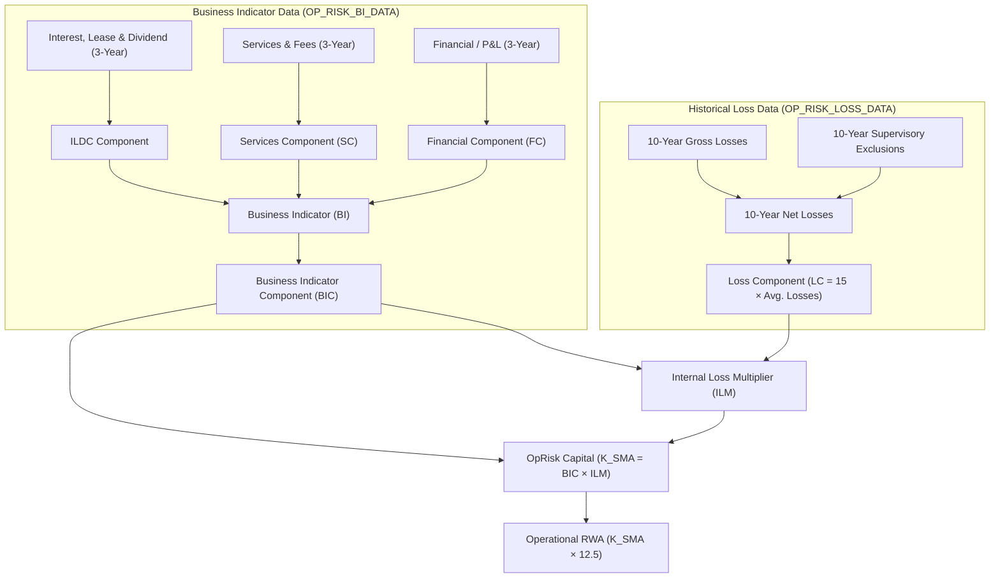

# Operational Risk Capital Calculator — Data Dictionary
**Basel III / Basel IV Standardised Measurement Approach (SMA)**

**Document Version:** 1.0  
**Target Inputs:**  
- [`bi_data_template.sas`](file:///d:/MyApp/SAS_OpRisk/inputs/bi_data_template.sas) (`work.OP_RISK_BI_DATA`)
- [`historical_loss_template.sas`](file:///d:/MyApp/SAS_OpRisk/inputs/historical_loss_template.sas) (`work.OP_RISK_LOSS_DATA`)  
**Output Location:** [`d:\MyApp\SAS_OpRisk\outputs\`](file:///d:/MyApp/SAS_OpRisk/outputs)

---

## 1. Overview & Regulatory Framework

This data dictionary defines the specifications, data types, business definitions, and regulatory alignment for the input datasets used in the Operational Risk Capital Calculator. The data schema strictly complies with the **Basel Committee on Banking Supervision (BCBS)** standards for the **Standardised Measurement Approach (SMA)** for Operational Risk (BCBS CRE30 / CRE32 and Pillar 3 OR1 disclosures):



---

## 2. Business Indicator Data Template (`bi_data_template.sas`)

* **Dataset Name:** `work.OP_RISK_BI_DATA` (or staging table `OP_RISK_DATA`)
* **Primary Key:** `ENTITY_ID`
* **Time Horizon:** 3 consecutive rolling financial years:
  * `_Y0`: Current reporting year (Year $t$)
  * `_YM1`: Year minus 1 (Year $t-1$)
  * `_YM2`: Year minus 2 (Year $t-2$)
* **Format:** Comma-delimited inline data (`dlm=',' dsd`)

### Field Specifications

| Column Name | SAS Type | Length | SMA Component | Field Label / Regulatory Description | Validation & Rules | Sample Value |
| :--- | :--- | :--- | :--- | :--- | :--- | :--- |
| `ENTITY_ID` | Character (`$`) | 32 | Dimension | **Reporting Entity Identifier**. Unique legal entity or business unit code (e.g., `CLU`, `RLU`, `GLU`, `BHC`). | Primary Key, Not Null | `Test` |
| `INTERNAL_ORG_RK` | Numeric | 8 | Dimension | **Internal Organization Surrogate Key**. Internal data warehouse dimension identifier. | Integer $\ge 0$ | `1000000` |
| `INTEREST_INCOME_Y0` | Numeric | 8 | ILDC | **Interest Income (Year $t$)**. Total interest income from all financial assets, leases, and other interest-bearing operations. | Numeric, $\ge 0$ | `15000000` |
| `INTEREST_INCOME_YM1` | Numeric | 8 | ILDC | **Interest Income (Year $t-1$)**. | Numeric, $\ge 0$ | `1450000` |
| `INTEREST_INCOME_YM2` | Numeric | 8 | ILDC | **Interest Income (Year $t-2$)**. | Numeric, $\ge 0$ | `1400000` |
| `INTEREST_EXPENSES_Y0` | Numeric | 8 | ILDC | **Interest Expenses (Year $t$)**. Total interest expenses from all financial liabilities, funding, and leasing transactions. | Numeric, $\ge 0$ | `950000` |
| `INTEREST_EXPENSES_YM1` | Numeric | 8 | ILDC | **Interest Expenses (Year $t-1$)**. | Numeric, $\ge 0$ | `900000` |
| `INTEREST_EXPENSES_YM2` | Numeric | 8 | ILDC | **Interest Expenses (Year $t-2$)**. | Numeric, $\ge 0$ | `850000` |
| `INTEREST_EARNING_ASSETS_Y0` | Numeric | 8 | ILDC | **Interest Earning Assets (Year $t$)**. Total gross outstanding loans, advances, debt securities, and other interest-bearing assets. | Numeric, $\ge 0$ | `62000000` |
| `INTEREST_EARNING_ASSETS_YM1` | Numeric | 8 | ILDC | **Interest Earning Assets (Year $t-1$)**. | Numeric, $\ge 0$ | `59000000` |
| `INTEREST_EARNING_ASSETS_YM2` | Numeric | 8 | ILDC | **Interest Earning Assets (Year $t-2$)**. | Numeric, $\ge 0$ | `56000000` |
| `DIVIDEND_INCOME_Y0` | Numeric | 8 | ILDC | **Dividend Income (Year $t$)**. Dividend income from equity holdings, investments in stocks, and funds not fully consolidated. | Numeric, $\ge 0$ | `1100000` |
| `DIVIDEND_INCOME_YM1` | Numeric | 8 | ILDC | **Dividend Income (Year $t-1$)**. | Numeric, $\ge 0$ | `1050000` |
| `DIVIDEND_INCOME_YM2` | Numeric | 8 | ILDC | **Dividend Income (Year $t-2$)**. | Numeric, $\ge 0$ | `1000000` |
| `FEE_COMMISSION_INCOME_Y0` | Numeric | 8 | SC | **Fee & Commission Income (Year $t$)**. Income earned from providing financial advice, fiduciary services, underwriting, and clearing. | Numeric, $\ge 0$ | `1300000` |
| `FEE_COMMISSION_INCOME_YM1` | Numeric | 8 | SC | **Fee & Commission Income (Year $t-1$)**. | Numeric, $\ge 0$ | `1250000` |
| `FEE_COMMISSION_INCOME_YM2` | Numeric | 8 | SC | **Fee & Commission Income (Year $t-2$)**. | Numeric, $\ge 0$ | `1200000` |
| `FEE_COMMISSION_EXPENSES_Y0` | Numeric | 8 | SC | **Fee & Commission Expenses (Year $t$)**. Expenses incurred from receiving financial, custody, clearing, and advisory services. | Numeric, $\ge 0$ | `900000` |
| `FEE_COMMISSION_EXPENSES_YM1` | Numeric | 8 | SC | **Fee & Commission Expenses (Year $t-1$)**. | Numeric, $\ge 0$ | `850000` |
| `FEE_COMMISSION_EXPENSES_YM2` | Numeric | 8 | SC | **Fee & Commission Expenses (Year $t-2$)**. | Numeric, $\ge 0$ | `800000` |
| `OTHER_OPE_INCOME_Y0` | Numeric | 8 | SC | **Other Operating Income (Year $t$)**. Income from ordinary banking activities not captured in other Business Indicator items. | Numeric, $\ge 0$ | `1400000` |
| `OTHER_OPE_INCOME_YM1` | Numeric | 8 | SC | **Other Operating Income (Year $t-1$)**. | Numeric, $\ge 0$ | `1350000` |
| `OTHER_OPE_INCOME_YM2` | Numeric | 8 | SC | **Other Operating Income (Year $t-2$)**. | Numeric, $\ge 0$ | `1300000` |
| `OTHER_OPE_EXPENSES_Y0` | Numeric | 8 | SC | **Other Operating Expenses (Year $t$)**. Operating expenses from ordinary banking operations (excluding administrative overhead & op risk losses). | Numeric, $\ge 0$ | `1000000` |
| `OTHER_OPE_EXPENSES_YM1` | Numeric | 8 | SC | **Other Operating Expenses (Year $t-1$)**. | Numeric, $\ge 0$ | `950000` |
| `OTHER_OPE_EXPENSES_YM2` | Numeric | 8 | SC | **Other Operating Expenses (Year $t-2$)**. | Numeric, $\ge 0$ | `900000` |
| `NET_PROFIT_LOSS_TRADING_BK_Y0` | Numeric | 8 | FC | **Net P&L Trading Book (Year $t$)**. Net profit or loss from securities, trading derivatives, foreign exchange, and commodities trading assets. | Numeric (Sign preserved in input; absolute value used in FC calculation) | `1600000` |
| `NET_PROFIT_LOSS_TRADING_BK_YM1` | Numeric | 8 | FC | **Net P&L Trading Book (Year $t-1$)**. | Numeric | `1550000` |
| `NET_PROFIT_LOSS_TRADING_BK_YM2` | Numeric | 8 | FC | **Net P&L Trading Book (Year $t-2$)**. | Numeric | `1500000` |
| `NET_PROFIT_LOSS_BANKING_BK_Y0` | Numeric | 8 | FC | **Net P&L Banking Book (Year $t$)**. Net profit or loss from banking book assets and liabilities including fair value adjustments & hedge ineffectiveness. | Numeric (Sign preserved in input; absolute value used in FC calculation) | `1800000` |
| `NET_PROFIT_LOSS_BANKING_BK_YM1` | Numeric | 8 | FC | **Net P&L Banking Book (Year $t-1$)**. | Numeric | `1750000` |
| `NET_PROFIT_LOSS_BANKING_BK_YM2` | Numeric | 8 | FC | **Net P&L Banking Book (Year $t-2$)**. | Numeric | `1700000` |
| `AVG_ANNUAL_OP_RISK_LOSSES` | Numeric | 8 | Loss / ILM | **Average Annual Operational Risk Losses**. 10-year historical average annual net operational risk losses (used directly when detailed historical loss grid is bypassed). | Numeric, $\ge 0$ | `40000` |

---

## 3. Historical Loss Data Template (`historical_loss_template.sas`)

* **Dataset Name:** `work.OP_RISK_LOSS_DATA`
* **Primary Key:** `ENTITY_ID`
* **Time Horizon:** 10 consecutive rolling financial years:
  * `_Y0` (Current Year $t$) through `_YM9` (Year $t-9$)
* **Format:** Comma-delimited inline data (`dlm=',' dsd`)
* **Regulatory Reference:** BCBS CRE30.17–30.29 & Pillar 3 Disclosure Template OR1.

### Field Specifications

| Column Group | Suffixes | SAS Type | Length | Field Label / Regulatory Description | Validation & Rules | Sample Value |
| :--- | :--- | :--- | :--- | :--- | :--- | :--- |
| `ENTITY_ID` | N/A | Character (`$`) | 32 | **Reporting Entity Identifier**. Unique legal entity code matching the BI data table. | Primary Key, Not Null | `Test` |
| `LOSS_AMT_Y0` – `LOSS_AMT_YM9` | `_Y0` through `_YM9` | Numeric | 8 | **Gross Operational Loss Amount Net of Recoveries**. Total financial loss amount for operational risk events occurring or recognized in the respective annual period (net of direct recoveries, before insurance). | 10 columns, Numeric $\ge 0$ | `142000`, `38000`, `45000`, ... |
| `LOSS_CNT_Y0` – `LOSS_CNT_YM9` | `_Y0` through `_YM9` | Numeric | 8 | **Total Loss Event Count**. Total number of operational risk loss events exceeding the data collection threshold for the annual period. | 10 columns, Integer $\ge 0$ | `5`, `4`, `6`, `4`, `5`, ... |
| `EXC_AMT_Y0` – `EXC_AMT_YM9` | `_Y0` through `_YM9` | Numeric | 8 | **Supervisory Excluded Loss Amount**. Total operational risk loss amount approved by national supervisors for exclusion (e.g., divested business units, extraordinary non-recurring legacy legal settlements). | 10 columns, Numeric $\ge 0$, $\le \text{LOSS\_AMT}$ | `0`, `0`, `0`, ... |
| `EXC_CNT_Y0` – `EXC_CNT_YM9` | `_Y0` through `_YM9` | Numeric | 8 | **Supervisory Excluded Loss Count**. Number of excluded operational risk loss events approved by supervisors. | 10 columns, Integer $\ge 0$, $\le \text{LOSS\_CNT}$ | `0`, `0`, `0`, ... |
| `ILM_USES_LOSSES` | N/A | Numeric | 8 | **ILM Loss Usage Flag / Jurisdictional Discretion**. Specifies whether internal loss data is applied to calculate ILM: <br>• `1` (True / Active): Compute $ILM = \ln\left(\exp(1) - 1 + (LC / BIC)^{0.8}\right)$<br>• `0` (False / Bucket 1 / National Discretion): Force $ILM = 1.0$. | Binary flag (`0` or `1`) | `1` |
| `LOSS_THRESHOLD` | N/A | Numeric | 8 | **Data Collection Loss Threshold**. Minimum loss amount threshold for recording events and computing loss component (Standard BCBS threshold: €20,000 / $20,000; high-quality threshold: €100,000 / $100,000). | Numeric, typically `20000` or `100000` | `100000` |

---

## 4. Operational Risk SMA Mathematical Logic & Component Mapping

### 4.1 Three-Year Historical Averages

For each 3-year BI metric, compute the arithmetic mean:
$$\overline{X} = \frac{X_{Y0} + X_{YM1} + X_{YM2}}{3}$$

Specifically for Net Interest Income and Trading/Banking P&L:
$$\overline{\text{Net Interest}} = \frac{|\text{INC}_{Y0} - \text{EXP}_{Y0}| + |\text{INC}_{YM1} - \text{EXP}_{YM1}| + |\text{INC}_{YM2} - \text{EXP}_{YM2}|}{3}$$
$$\overline{\text{Trading P\&L}} = \frac{|\text{TRADING}_{Y0}| + |\text{TRADING}_{YM1}| + |\text{TRADING}_{YM2}|}{3}$$
$$\overline{\text{Banking P\&L}} = \frac{|\text{BANKING}_{Y0}| + |\text{BANKING}_{YM1}| + |\text{BANKING}_{YM2}|}{3}$$

### 4.2 Business Indicator Components

1. **Interest, Leases and Dividend Component (ILDC):**
   $$\text{ILDC} = \min\left(\overline{\text{Net Interest Income}}, 0.0225 \times \overline{\text{Interest Earning Assets}}\right) + \overline{\text{Dividend Income}}$$

2. **Services Component (SC):**
   $$\text{SC} = \max\left(\overline{\text{Other Op Income}}, \overline{\text{Other Op Expense}}\right) + \max\left(\overline{\text{Fee Income}}, \overline{\text{Fee Expense}}\right)$$

3. **Financial Component (FC):**
   $$\text{FC} = \overline{\text{Trading Book P\&L}} + \overline{\text{Banking Book P\&L}}$$

4. **Total Business Indicator (BI):**
   $$\text{BI} = \text{ILDC} + \text{SC} + \text{FC}$$

### 4.3 Business Indicator Component (BIC) Marginal Buckets

| Bucket | BI Range (EUR / Base Currency) | Marginal Coefficient ($\alpha$) | BIC Calculation Formula |
| :---: | :--- | :---: | :--- |
| **Bucket 1** | $\le 1{,}000{,}000{,}000$ (1 Bn) | **12%** ($0.12$) | $\text{BIC} = 0.12 \times \text{BI}$ |
| **Bucket 2** | $> 1\text{ Bn}$ and $\le 30{,}000{,}000{,}000$ (30 Bn) | **15%** ($0.15$) | $\text{BIC} = 0.12 \times 1\text{Bn} + 0.15 \times (\text{BI} - 1\text{Bn})$ |
| **Bucket 3** | $> 30{,}000{,}000{,}000$ (30 Bn) | **18%** ($0.18$) | $\text{BIC} = 0.12 \times 1\text{Bn} + 0.15 \times 29\text{Bn} + 0.18 \times (\text{BI} - 30\text{Bn})$ |

### 4.4 Loss Component (LC) & Internal Loss Multiplier (ILM)

1. **Annual Net Losses:**
   $$\text{Net Loss}_i = \max\left(0, \text{LOSS\_AMT}_i - \text{EXC\_AMT}_i\right) \quad \text{for } i \in \{Y0, YM1, \dots, YM9\}$$

2. **Loss Component (LC):**
   $$\text{LC} = 15 \times \left(\frac{1}{10}\sum_{i=0}^{9} \text{Net Loss}_i\right) \quad \text{or } 15 \times \text{AVG\_ANNUAL\_OP\_RISK\_LOSSES}$$

3. **Internal Loss Multiplier (ILM):**
   $$\text{ILM} = \begin{cases} 1.0 & \text{if } \text{ILM\_USES\_LOSSES} = 0 \text{ or Bucket 1 (or by regulatory discretion)} \\ \ln\left(\exp(1) - 1 + \left(\frac{\text{LC}}{\text{BIC}}\right)^{0.8}\right) & \text{if } \text{ILM\_USES\_LOSSES} = 1 \end{cases}$$

### 4.5 Minimum Capital Requirement & Risk-Weighted Assets (RWA)

1. **Operational Risk Capital Requirement ($K_{SMA}$):**
   $$K_{SMA} = \text{BIC} \times \text{ILM}$$

2. **Operational Risk-Weighted Assets ($\text{RWA}_{OpRisk}$):**
   $$\text{RWA}_{OpRisk} = K_{SMA} \times 12.5$$

---

## 5. Implementation & Usage Guidelines

### SAS Batch Execution
When using these templates in SAS batch mode, read the data using the standard `INFILE DATALINES DSD DLM=','`:
```sas
/* BI Data Ingestion */
%include "inputs/bi_data_template.sas";

/* Historical Loss Data Ingestion */
%include "inputs/historical_loss_template.sas";

/* Execute Calculation Engine */
%include "SAS_scripts/01_Configure Common Functions.sas";
%include "SAS_scripts/02_Calculate OpRisk RWA and Capital.sas";
```

### Data Integrity & Validation Checks
1. **Entity Consistency:** Ensure `ENTITY_ID` in `OP_RISK_BI_DATA` matches `ENTITY_ID` in `OP_RISK_LOSS_DATA`.
2. **Missing Values:** Replace any missing or undefined numeric inputs with `0` prior to summation.
3. **Exclusion Validation:** Ensure `EXC_AMT_*` $\le$ `LOSS_AMT_*` and `EXC_CNT_*` $\le$ `LOSS_CNT_*`.
4. **Currency Units:** All monetary values across BI and Loss tables must be provided in the identical base currency (e.g., EUR, USD, or TWD).
