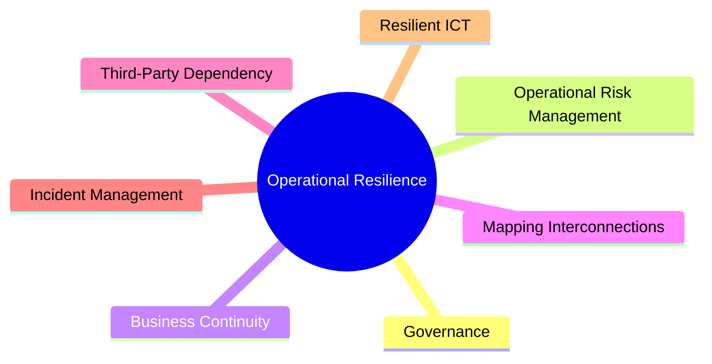

# Principles for Operational Resilience

The **Principles for Operational Resilience** were published by the Basel Committee on Banking Supervision (BCBS) in March 2021. The guidelines aim to strengthen a bank's ability to withstand, adapt to, and recover from operational disruptions (such as cyber incidents, technology failures, pandemics, or natural disasters) that could impact critical operations and threaten financial stability.

The framework assumes that operational disruptions *will* occur and shifts focus from purely preventing failures to ensuring **tolerance for disruption** is defined and maintained.

---

## The 7 Core Principles

The Basel Committee outlines seven fundamental pillars for operational resilience:

1. **Governance**: Banks should leverage existing governance structures to oversee the operational resilience framework. The Board of Directors holds ultimate accountability for defining tolerance for disruption and allocating resources.
2. **Operational Risk Management**: Banks should use their operational risk management functions to identify, assess, and manage potential threats and vulnerabilities on an ongoing basis.
3. **Business Continuity Planning and Testing**: Banks must maintain active business continuity plans and conduct testing under a range of severe but plausible scenarios (e.g., system outages or facility access loss).
4. **Mapping of Interconnections and Interdependencies**: Map the internal and external dependencies (people, systems, processes, data, and third-party providers) required to deliver critical operations.
5. **Third-Party Dependency Management**: Exercise robust oversight of third-party arrangements, including cloud providers, managing concentration risks and ensuring vendor exit strategies are established.
6. **Incident Management**: Maintain documented incident response procedures to rapidly detect, escalate, and resolve operational disruptions while communicating with stakeholders.
7. **Resilient ICT (including Cybersecurity)**: Maintain robust information and communication systems, with cyber defense controls that are regularly validated and tested.

---

## Critical Operations and Tolerance for Disruption

* **Critical Operations**: Operations that, if disrupted, would cause material client detriment, impact the bank's safety and soundness, or disrupt the systemic stability of the financial system.
* **Tolerance for Disruption**: The maximum acceptable level of disruption to a critical operation (expressed as a time limit, volume limit, or qualitative threshold) beyond which serious systemic harm would occur.

---

## See Also

* [[Standardised Measurement Approach]]
* [[DORA Compliance]]
* [[Key Risk Indicators]]
* [[Scenario Analysis]]
