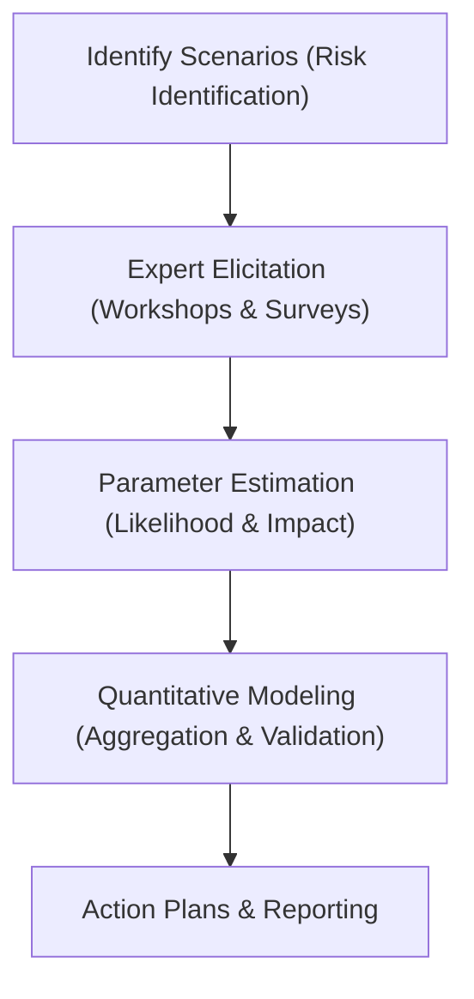

# Scenario Analysis

**Scenario Analysis** is a forward-looking risk management technique used to identify and evaluate the potential impact of extreme, low-frequency, high-severity operational risk events (often called "tail risks"). 

Unlike historical loss data collection, which looks backward at events that have already occurred, Scenario Analysis is designed to explore severe but plausible future events that the bank has not yet experienced.

---

## Core Objectives of Scenario Analysis

1. **Address Information Gaps**: Historical loss databases may lack data on rare but catastrophic events. Scenarios fill these gaps.
2. **Support Stress Testing**: Evaluate the firm's resilience under severe stress conditions (e.g., severe cyberattacks, pandemics, or infrastructure collapse).
3. **Inform Risk Appetite**: Help senior management establish boundaries for acceptable risk exposure.

---

## The Scenario Generation Process

A robust scenario program follows these key steps:

### 1. Risk Identification
Identify areas of vulnerability (e.g., cloud outsourcing concentration, regulatory shifts, or transaction execution failure) by combining internal logs, external losses, and expert consensus.

### 2. Expert Elicitation
Conduct workshops with senior leaders, risk managers, and business owners. Participants use structured techniques (such as Delphi methods) to reduce cognitive bias and estimate:
* **Frequency**: How often could this event occur? (e.g., once in 10, 50, or 100 years).
* **Severity**: If it occurs, what would the financial, legal, and operational impact be?

### 3. Quantitative Modeling & Estimation
Model the probability distributions of losses (e.g., using Log-Normal or Generalized Pareto Distributions). These models help determine the tail-end values for risk capital assessments.

---

## Integration under Basel III SMA

Under the Basel III Standardised Measurement Approach (SMA) minimum capital framework, capital is computed using a financial formula:
$$ORC = BIC \times ILM$$

While Scenario Analysis is no longer an input to the *regulatory minimum capital* formula (which replaced the Advanced Measurement Approach), it remains a regulatory expectation under the **Principles for Sound Management of Operational Risk (PSMOR)** for internal governance, economic capital modeling (ICAAP), and operational resilience testing.

---

## See Also

* [[Standardised Measurement Approach]]
* [[Risk and Control Self-Assessment]]
* [[External Loss Databases]]
* [[Principles for Operational Resilience]]
